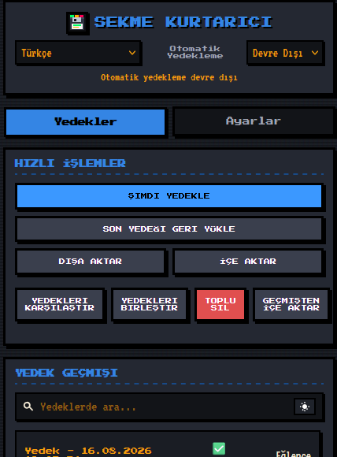
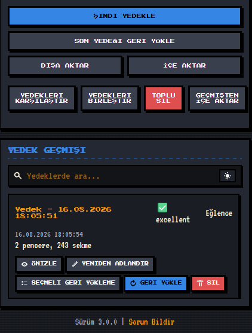
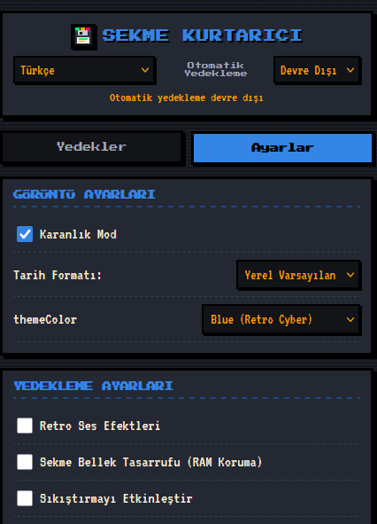
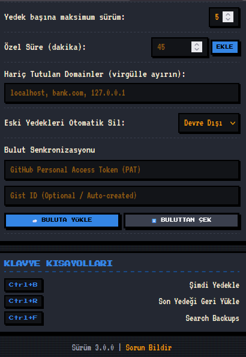

  
  <h1>TabSaver v3.0.0</h1>
  
<b>Retro Pixel Arcade Edition</b>

  
  

    A high-performance, retro 8-bit pixel themed WebExtension (Firefox & Chrome Manifest V3) for tab saving, auto-backups, cross-device sync, and RAM management.
     
    <i>Sekme yedekleme, otomatik yedekleme, cihazlar arası eşitleme ve RAM koruma özelliklerine sahip retro 8-bit piksel temalı modern web eklentisi.</i>
  

  

    
    &nbsp;&nbsp;
    
  

---

## 🖼️ Ekran Görüntüleri / Screenshots

| | |
| :---: | :---: |
|  |  |
|  |  |

---

## 🌟 Ana Özellikler / Key Features

### 👾 Retro Pixel Arcade Tasarım & Sesler
- **Piksel Tasarım Sistemi**: Google Fonts (`Press Start 2P`, `VT323`) ve 16x16 özel piksel SVG ikonlar.
- **6 Canlı Renk Paleti**: Klasik Yeşil Arcade, Çim Kırmızı, Retro Siber Mavi, Synth 16-Bit Mor, GameBoy Amber, Matris Siyan.
- **🎵 8-Bit Web Audio Chiptune Efektleri**: Yedek alma, geri yükleme, silme ve tıklamalar için kod tabanlı sentezlenen nostaljik sesler.
- **Koyu & Açık Mod**: Retro Kağıt Açık Mod ve Chiptune Arcade Koyu Mod.

### 🚀 Süper Güç Özellikleri / Power Utilities
- **⚡ Sekme Bellek Tasarrufu (RAM Saver / Lazy Restore)**: Geri yüklenen sekmeleri askıda (`discarded: true`) açarak RAM kullanımını ve donmaları engeller.
- **🧹 Mükerrer Sekme Temizleyici (Duplicate Tab Cleaner)**: Tüm pencerelerdeki aynı açık URL sekmelerini tek tıkla tarar ve temizler.
- **🔒 PIN Korumalı Şifreli Kasa**: Hassas yedekleri parola/PIN ile şifreleme (`simpleEncrypt` / `simpleDecrypt`).
- **🧠 Akıllı Otomatik Kategorileme**: Sekmeleri alan adlarına göre otomatik olarak İş, Eğlence, Alışveriş, Araştırma, Eğitim, Kişisel kategorilerine ayırır.
- **📌 Domain Kara Listesi (Blacklist)**: Belirtilen domainleri (`localhost`, `127.0.0.1` vb.) yedeklerden otomatik hariç tutar.
- **🕒 Otomatik Eski Yedek Temizliği (Auto-Prune)**: 7 ila 90 gün arasındaki eski yedekleri otomatik temizler.
- **☁️ GitHub Gist Bulut Eşitleme**: GitHub PAT tokenı ile cihazlar arası yedek aktarımı.
- **📋 Markdown Okuma Listesi Kopyalama**: Yedeği tek tıkla okuma listesi formatında (`[Başlık](URL)`) panoya kopyalama.
- **🪟 Tek Pencere Restorasyonu & Toplu Silme**: Yedeğin sadece istenen penceresini açma veya çoklu yedek silme.

---

## 🌐 6 Desteklenen Dil / Supported Languages

- 🇹🇷 **Türkçe**
- 🇬🇧 **English**
- 🇰🇷 **한국어 (Korean)**
- 🇨🇳 **中文 (Chinese)**
- 🇷🇺 **Русский (Russian)**
- 🇦🇪 **العربية (Arabic - Native RTL)**

---

## 📦 Kurulum ve İndirme / Download & Install

TabSaver'ı resmi mağazalardan doğrudan tarayıcınıza ekleyebilirsiniz:

- 🦊 **Firefox:** [Firefox Add-ons](BURAYA_FIREFOX_LINKI)
- 🌐 **Chrome / Edge / Brave:** [Chrome Web Store](BURAYA_CHROME_LINKI) *(Yakında / Coming Soon)*

---

## 📄 Lisans & Gizlilik / License & Privacy

- Tüm verileriniz yerel tarayıcı depolamanızda saklanır (`storage.local`).
- Harici hiçbir sunucuya veri gönderilmez (Kullanıcı tarafından isteğe bağlı GitHub Gist bulut eşitlemesi hariç).
- Detaylı bilgi için: [Gizlilik Politikası / Privacy Policy](PRIVACY_POLICY.md)
- Copyright © 2026 TabSaver. All rights reserved.

