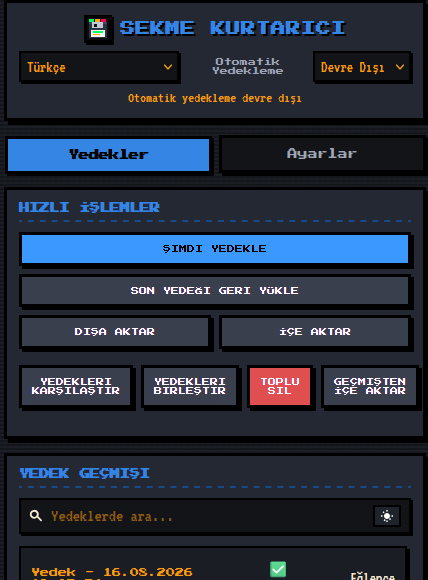
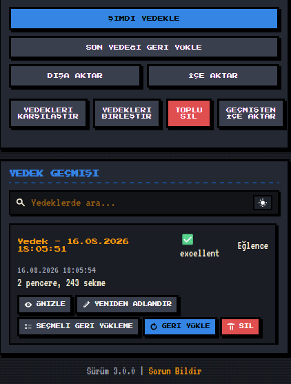
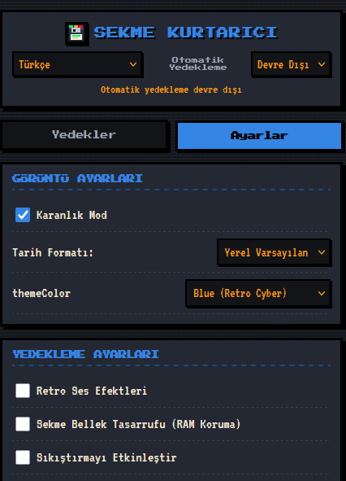
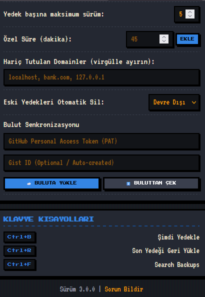

# 🎮 TabSaver v3.0.0 (Retro Pixel Arcade Edition)

> A high-performance, retro 8-bit pixel themed WebExtension (Firefox & Chrome Manifest V3) for tab saving, auto-backups, cross-device sync, and RAM management.

---

## 🌟 Key Features

### 🎮 Retro Pixel Arcade UI & Audio
- **Pixel Design System**: Retro arcade aesthetic with Google Fonts (`Press Start 2P`, `VT323`) and custom 16x16 pixel SVG icons.
- **6 Dynamic Color Themes**: Classic Green Arcade, Crimson Red, Retro Cyber Blue, Synth 16-Bit Purple, GameBoy Amber, Matrix Cyan.
- **🎵 8-Bit Web Audio Chiptune Effects**: Native Web Audio API retro sound effects for backup, restore, delete, and clicks (toggleable in Settings).
- **Light & Dark Themes**: Retro Paper Light Mode and Chiptune Arcade Dark Mode.

### 🚀 Power Utilities
- **⚡ Lazy Tab Restore (RAM Saver)**: Opens restored tabs in suspended (`discarded: true`) state to prevent memory spikes and browser freezing.
- **🧹 Duplicate Tab Cleaner**: One-click scanner and cleaner for duplicate open URLs across all windows.
- **🔒 Password-Protected Encrypted Vault**: PIN/Password protection (`simpleEncrypt` / `simpleDecrypt`) with a retro PIN unlock modal.
- **🧠 Smart Auto-Categorization**: Automatic domain analysis categorizing tabs into Work, Personal, Research, Shopping, Entertainment, Education.
- **📌 Domain Exclusion Blacklist**: Ignore specified domains (`localhost`, `127.0.0.1`, etc.) from being saved.
- **🕒 Auto-Pruning Retention**: Automatically clean up backups older than 7 to 90 days.
- **☁️ GitHub Gist Cloud Sync**: Cross-device cloud sync (Push & Pull) via GitHub Personal Access Token.
- **📋 Export as Markdown**: One-click export of any backup into a formatted Markdown reading list (`[Title](URL)`).
- **🪟 Single-Window Restore & Bulk Delete**: Restore individual windows or bulk-delete multiple backups with checkboxes.

### 🌐 6 Supported Languages
- 🇹🇷 **Türkçe**
- 🇬🇧 **English**
- 🇰🇷 **한국어 (Korean)**
- 🇨🇳 **中文 (Chinese)**
- 🇷🇺 **Русский (Russian)**
- 🇦🇪 **العربية (Arabic)** *(With native RTL layout support)*

---

## 🖼️ Screenshots






---

## 📦 Installation Guide

### Manual Load (Developer Mode)

#### Firefox
1. Open Firefox and navigate to `about:debugging#/setup`.
2. Click **"This Firefox"** in the left sidebar.
3. Click **"Load Temporary Add-on..."**.
4. Select `manifest.json` from this project folder.

#### Chrome / Edge / Brave
1. Open your browser and navigate to `chrome://extensions`.
2. Enable **Developer mode** toggle in the top-right corner.
3. Click **"Load unpacked"**.
4. Select this project folder.

---

## 📁 Project Structure

```text
├── manifest.json         # Extension Manifest V3 configuration
├── background.js         # Service worker, alarms, cloud sync, encryption
├── popup.html            # Main extension UI container
├── popup.js              # UI logic, sound synth, 6-language dictionaries
├── icons/                # 8-bit retro floppy disk SVG logo and icons
├── _locales/             # Extension locale manifests (en, tr, ko, zh, ru, ar)
├── screenshots/          # Preview screenshots for web stores & GitHub
└── README.md             # Project documentation
```

---

## 📄 License

MIT License.
